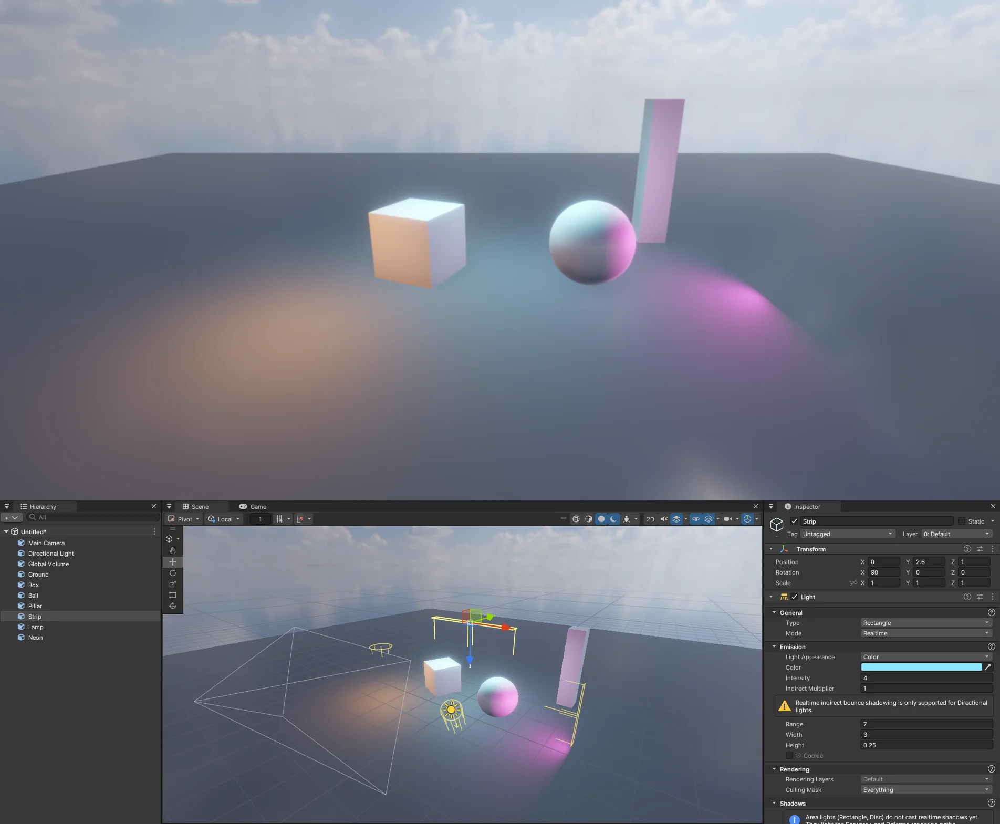

# 면광 (Area Light — Rectangle · Disc)

빛이 한 점이 아니라 **면** (사각형 · 원판) 에서 나오는 실시간 빛입니다. 창 · 형광등 · 간판 · 천장 조명 · 모니터처럼 넓게 퍼지는 부드러운 빛과, 매끈한 바닥에 비치는 **사각형 모양 반사** 를 만듭니다. Unity URP 의 Area Light 는 굽기 전용이지만, NOVA 는 Unity **HDRP** 처럼 실시간으로 그립니다 (LTC).



## 쓰는 법

- **GameObject > Light > Area Light** (Rectangle) — 또는 Light 컴포넌트 Type 을 **Rectangle** · **Disc** 로
- 빛은 Transform 의 **forward (+Z)** 쪽으로만 나간다 (한쪽 면). 새 Area Light 는 높이 3 m 에서 아래를 비춘다 (회전 90, 0, 0)

| 값 | 뜻 |
|---|---|
| Color · Intensity | 색 · 세기. **크기를 바꿔도 전체 밝기는 같다** (HDRP 의 루멘처럼) — 작게 줄이면 같은 세기의 점광을 마주 볼 때와 같은 밝기 |
| Range | 빛 면에서 가장 가까운 점부터 이 거리에서 부드럽게 0 (Forward+ 클러스터 컬링도 이 범위) |
| Width · Height (Rectangle) · Radius (Disc) | 면 크기 (m) |

- 그리는 길: Rendering Path **Forward+** (기본) · **Deferred** 의 클러스터 빛 — 한 화면 최대 1024 개 (점광 · 스포트광과 함께). **Forward** (클러스터 끔) 에서는 비추지 않는다
- 그림자는 아직 없다. lilToon (툰 셰이더) 은 면광을 받지 않는다

## CLI · C#

```
nova create area-light --name Panel --position 0,2.5,0          # Rectangle (disc-light = Disc)
nova set Panel --component Light --values "{\"areaLightSize\":[2,0.3],\"intensity\":3,\"areaLightRange\":6}"
nova set Panel --component Light --values "{\"lightType\":4}"   # 3 Rectangle, 4 Disc
nova forwardplus info                                            # areaLights = 이 화면의 면광 수
```

```csharp
var l = GetComponent<Light>();
if (l.type == LightType.Rectangle)
    l.areaSize = new Vector2(2f, 0.3f);   // Disc 는 x = 반지름 (Unity Light.areaSize)
```

저장: `lightType` (3 Rectangle, 4 Disc — Unity LightType 과 같은 번호), `areaLightDiffuse`, `areaLightRange`, `areaLightSize`.

## 동작 (엔진 안)

- **LTC** (Linearly Transformed Cosines — Heitz · Dupuy · Hill · Neubelt, SIGGRAPH 2016): GGX 반사 분포를 3x3 행렬로 코사인 분포에 맞춰 두고 (64 x 64 표 두 장), 빛 다각형을 그 공간으로 옮겨 **해석적으로 적분** 한다. 확산 = 같은 적분 (행렬 = 단위). 지평선 아래로 잘리는 몫은 구 적분 표 (clipless)
- Rectangle = 꼭짓점 4 개, Disc = 넓이가 같은 정팔각형 (꼭짓점 8 개)
- 빛 목록: `LightManager` 가 면광을 그림자 칸 (앞의 4 개) 밖의 클러스터 빛으로 (`AdditionalLight` Type 2 · 3, 반 크기 축 두 개), `ClusteredLighting` 이 면의 모서리까지 감싸는 구로 클러스터에 넣는다. 빛 자료 4 텍셀 = (자리, 범위) · (색, 종류) · (축 X, 축 Y.x) · (축 Y.y, 마스크, 마스크, 축 Y.z)
- LTC 표는 클러스터 텍스처 (RGBA32F, 가로 1024) 의 24576 텍셀부터 — 따로 샘플러를 쓰지 않아 OpenGL 의 프로그램당 샘플러 32 개 제한에 걸리지 않는다. 셰이더가 Load 4 번으로 쌍선형
- 셰이더: `Shaders/32. InstancedBasic.fx` 의 `ShadeAreaLight` · `LtcPolygon` · `LtcTexel` — 모든 Lit 재질 (메시 · Deferred · 지형 · 나무 · 바위 · 풀 · 데칼 · Shader Graph) 이 같은 `ShadeLit` 를 거친다
- 표 데이터: `Source/Graphics/DX11/LtcTables.h` (원본 `ltc_1.dds` · `ltc_2.dds` 의 반 정밀도 값), 라이선스 `ThirdParty/LTC/LICENSE` (BSD)
- 파일: `Source/Scene/Light.*` (종류 · Inspector · 기즈모 · 저장), `Source/Scene/LightManager.*`, `Source/Graphics/DX11/ClusteredLighting.cpp`, `Source/Editor/SceneViewOverlay.cpp` (사각형 · 원 기즈모)

## 검사

`Tools/tests/run_tests.ps1 -Only arealight` — 위에서 내려다본 바닥의 밝기 (켬 − 끔): 빛 아래 · 범위 밖, 긴 사각형은 긴 쪽으로 더 퍼짐, 한쪽 면, 크기를 두 배로 해도 먼 바닥 밝기가 같음, Disc 는 둥글게, Deferred 같음, 저장 값 · C#, OpenGL.

## 아직

- 면광 그림자 (HDRP 처럼 면 가운데에서 그림자 맵 + 부드러운 가장자리), 쿠키 (면에 텍스처 — 모니터 · 스테인드글라스)
- Tube (선) 빛, 두 면 빛, lilToon 에서 받기, Forward 경로
