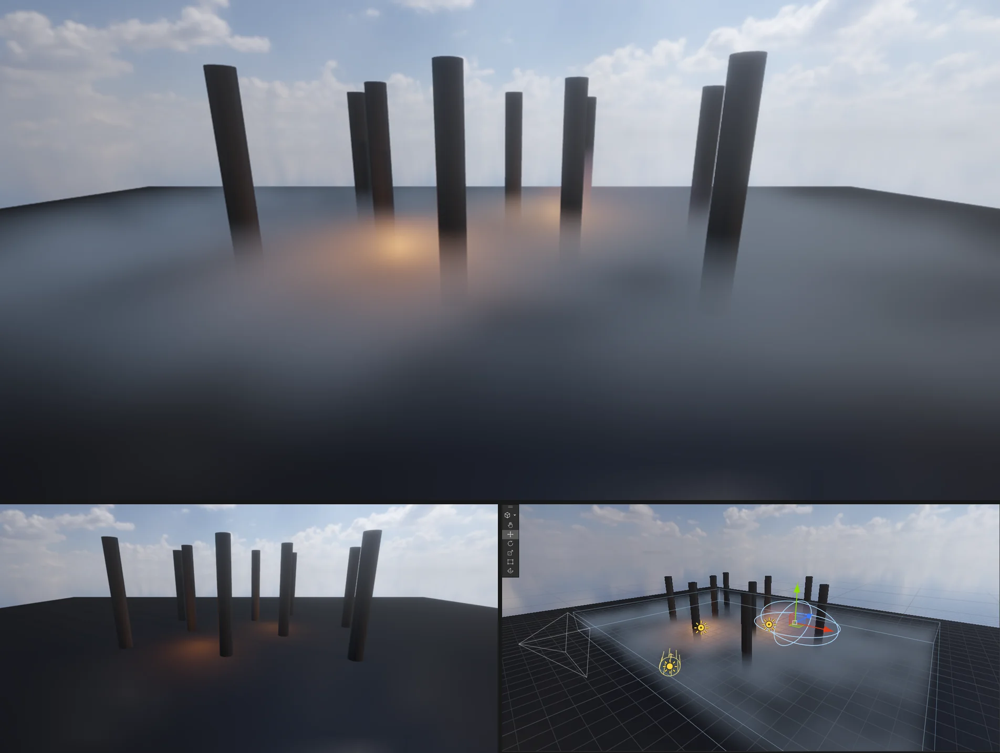

# Fog Volume (Local Volumetric Fog)

한 곳에만 있는 안개입니다 — 늪 위에 깔린 안개, 동굴 · 지하실의 먼지, 성 안 횃불 둘레의 연기, 골짜기에 고인 안개. 이름과 값은 Unity **HDRP 의 Local Volumetric Fog** (Godot 의 FogVolume) 와 같습니다. 장면 전체의 높이 안개 (Volume > Fog) 와 함께 쓸 수 있습니다.



## 쓰는 법

**GameObject > Rendering > Local Volumetric Fog** (또는 Add Component > Rendering > Local Volumetric Fog). Transform 의 위치 · 회전 · 크기와 Size 가 안개 상자를 정합니다.

| 값 | 뜻 |
|---|---|
| Single Scattering Albedo | 안개 색 (빛을 얼마나 흩뜨리나) |
| Fog Distance | 평균 자유 경로 (m) — 이 거리를 지나면 뒤가 63 % 가려진다. 작을수록 짙다 |
| Shape | Box · Ellipsoid (NOVA — Godot 의 타원체) |
| Size | 상자 크기 (m, Transform 크기를 곱한다) |
| Blend Distance · Falloff Mode | 가장자리 안쪽 이 폭에서 0 → 1 (Linear · Exponential) |
| Distance Fade Start · End | 카메라에서 멀어지면 옅어져 End 에서 0 |
| Density Mask: Mask Mode = Noise | 3D 노이즈로 덩어리지게 — Noise Tiling (덩어리 크기 m) · Noise Strength · Scroll Speed (m/s, 흐르는 안개). HDRP 의 Density Mask Texture 자리 |
| Lighting: Anisotropy · Ambient Multiplier | 빛 쪽을 볼 때 밝은 정도 (Henyey-Greenstein), 하늘 환경광 몫 (동굴 = 0 가까이) |

비추는 빛: **해** (방향광 0 — 캐스케이드 그림자로 나무 · 벽 사이 빛줄기), **가까운 점광 · 스포트광 · 면광 8 개** (안개 상자에 닿는 것 중 카메라에서 가까운 것 — 횃불 · 랜턴 둘레가 빛난다), **하늘 환경광**.

## CLI

```
nova create local-volumetric-fog --name Swamp --position 0,0.8,0
nova set Swamp --component LocalVolumetricFog --values "{\"size\":[30,2,30],\"fogDistance\":4,\"maskMode\":\"Noise\",\"noiseTiling\":5,\"scrollSpeed\":[0.4,0,0.2]}"
```

저장 키: `albedo`, `fogDistance`, `shape` (Box · Ellipsoid), `size`, `blendDistance`, `falloffMode`, `distanceFadeStart` · `distanceFadeEnd`, `maskMode` (None · Noise), `noiseTiling`, `noiseStrength`, `scrollSpeed`, `anisotropy`, `ambientMultiplier`.

## 동작 (엔진 안)

- 대기 패스 (`Shaders/50. Atmosphere.fx`, 불투명 + 하늘 다음 · 투명 전) 가 픽셀마다 카메라 → 장면 깊이 길이 각 볼륨 (단위 공간의 상자 · 구) 과 만나는 구간만 **24 걸음** 걷는다. 걸음 시작은 픽셀 · 프레임마다 흔들어 TAA 가 매끈하게
- 걸음마다 밀도 = 1 / Fog Distance × 가장자리 × 노이즈 × 거리 옅어짐, 빛 = 해 (그림자 맵) · 점광 8 개 · 하늘 (위 · 옆 하늘 색), 걸음 안은 해석적 적분 (1 − e^(−σ Δs)), 뒤 장면은 투과율만큼
- 볼륨은 카메라에서 가까운 16 개, **먼 것부터** 섞는다 (겹치면 앞의 것이 덮는다 — 서로 그림자는 없다)
- 파일: `Source/Scene/LocalVolumetricFog.*` (컴포넌트 · 기즈모 · 저장), `Source/Graphics/DX11/AtmospherePass.*` (`GatherLocalFog` — 볼륨 · 빛 고르기, 셰이더 값), `Source/Editor/EditorApp.cpp` (Game · Scene 뷰, 해 그림자)

## 검사

`Tools/tests/run_tests.ps1 -Only fogvolume` — 상자 너머만 바뀌고 위 하늘은 그대로, Fog Distance 가 작을수록 짙음, Noise 는 얼룩짐, Ellipsoid 는 모서리가 맑음, Distance Fade, 안개 속 점광이 주황으로 빛남 (안개 없이는 안 됨), 저장 값, OpenGL.

## 아직

- 밀도 마스크 텍스처 (3D 텍스처 에셋), 볼륨끼리 · 볼륨이 장면에 드리우는 그림자, 프록셀 (froxel) 격자로 볼륨이 많을 때 빠르게
- 점광 그림자 (점광 그림자 맵) 를 안개에서 읽기
