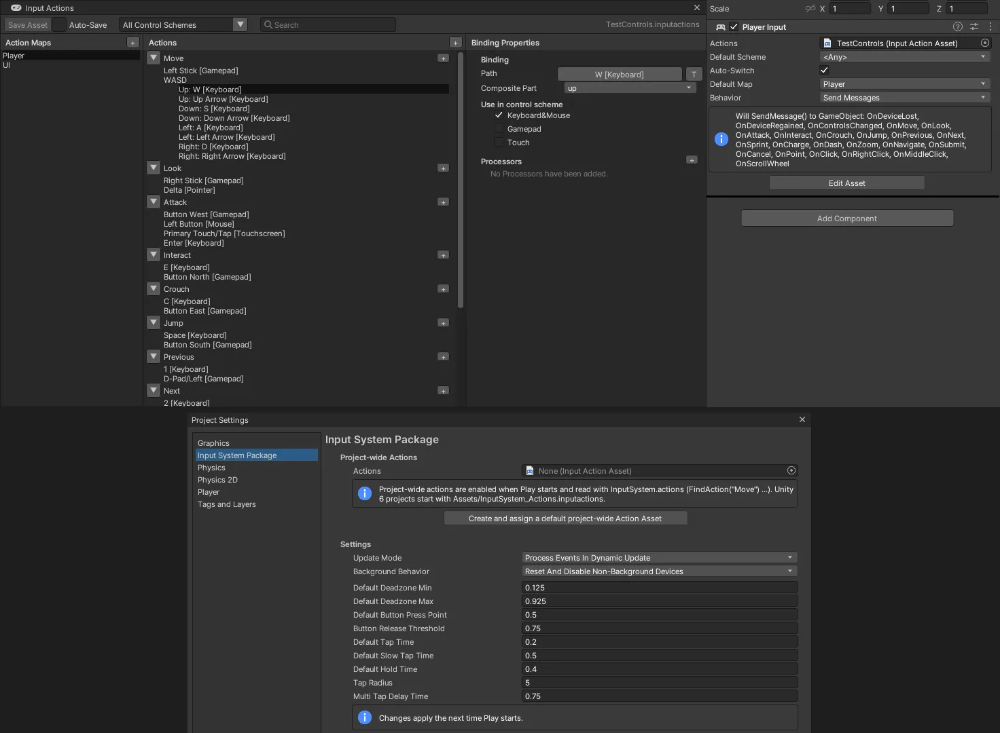

# Input System (로드맵 0-3 — Unity 의 Input System 패키지)

Unity 6 의 **Input System** (`com.unity.inputsystem`) 을 같은 이름 · 같은 파일 · 같은 동작으로 옮겼습니다. 네임스페이스만 `UnityEngine.InputSystem` → `NovaEngine.InputSystem` 입니다.

- **Input Action Asset (`.inputactions`)** — Unity 와 **같은 JSON** (maps · actions · bindings · controlSchemes). Unity 프로젝트의 파일을 그대로 읽고 씁니다 (Unity 6 의 기본 `InputSystem_Actions.inputactions` 포함)
- **동작** — Value · Button · Pass Through, 바인딩 · **합성** (2D Vector = WASD, 1D Axis, 3D Vector, 수정 키 + 키), **처리기** (데드존 · 뒤집기 · 배율 · 정규화), **상호작용** (Hold · Tap · Slow Tap · Multi Tap · Press)
- **장치** — 자판 · 마우스 · **게임패드** (Windows XInput — Xbox 호환 패드 4 개, 진동) · 터치 화면 (안드로이드)
- **PlayerInput** 컴포넌트 — 기본 맵, 컨트롤 스킴 자동 전환 (자판+마우스 ↔ 게임패드), Send Messages · Broadcast Messages · Unity Events · C# Events
- **다시 묶기** — `PerformInteractiveRebinding` (다음 누른 키 · 단추로), 덮어쓰기 저장 · 읽기 (`SaveBindingOverridesAsJson`)
- **프로젝트 동작** — `InputSystem.actions` (Unity 6 의 Project-wide Actions), Project Settings > Input System Package
- 편집기 — **Input Actions 창** (맵 · 동작 · 속성, 경로 고르기 + Listen), **Generate C# Class**, Inspector 의 `InputActionAsset` · `InputActionReference` · `InputAction` 필드
- 옛 `Input` (Input Manager) 도 그대로 — Unity 의 Active Input Handling = **Both**. 게임패드도 읽는다 (`GetAxis("Horizontal")` = 왼 스틱, `KeyCode.JoystickButton0` = A)



## 빠르게

```csharp
using NovaEngine;
using NovaEngine.InputSystem;

public class Hero : MonoBehaviour
{
    InputAction move, jump;

    void Start()
    {
        move = InputSystem.actions.FindAction("Move");   // Project Settings > Input System Package 의 에셋
        jump = InputSystem.actions.FindAction("Jump");
    }

    void Update()
    {
        Vector2 m = move.ReadValue<Vector2>();            // WASD · 화살표 · 왼 스틱 (데드존 0.125 ~ 0.925)
        transform.position += new Vector3(m.x, 0, m.y) * 5f * Time.deltaTime;
        if (jump.WasPressedThisFrame()) Debug.Log("jump");
    }
}
```

에셋이 없으면 **Project Settings > Input System Package > Create and assign a default project-wide Action Asset** (Unity 6 와 같은 Player · UI 맵, Keyboard&Mouse · Gamepad · Touch 스킴 — `Assets/InputSystem_Actions.inputactions`).

장치를 바로 읽어도 됩니다 (Unity 와 같다):

```csharp
if (Keyboard.current.spaceKey.wasPressedThisFrame) { }
Vector2 look = Mouse.current.delta.ReadValue();
if (Gamepad.current != null && Gamepad.current.buttonSouth.isPressed) Gamepad.current.SetMotorSpeeds(0.2f, 0.6f);
```

## PlayerInput

**Add Component > Input > Player Input**. Unity 의 Starter Assets 처럼 플레이어 오브젝트에 붙이고 Actions 에 에셋을 넣습니다 (없으면 **Create Actions...**).

| 칸 | 뜻 |
|---|---|
| Actions | `.inputactions` (Project 에서 끌어 놓기 · ⊙) |
| Default Scheme | `<Any>` 이면 지금 있는 장치로 쓸 수 있는 첫 스킴 |
| Auto-Switch | 다른 장치를 눈에 띄게 쓰면 (단추 · 축 0.5 이상) 그 장치의 스킴으로 — 바뀌면 `OnControlsChanged` |
| Default Map | 켤 맵 (`SwitchCurrentActionMap("UI")` 로 바꾼다) |
| Behavior | Send Messages · Broadcast Messages · Invoke Unity Events · Invoke C Sharp Events |

Send Messages 는 Unity 와 같이 **`"On" + 동작 이름`** 을 같은 GameObject 의 스크립트에 보냅니다 (performed 때, Value 동작은 놓을 때 canceled 도 — 스틱을 놓으면 0 이 온다):

```csharp
public class StarterInputs : MonoBehaviour
{
    public Vector2 move;
    public bool jump;
    void OnMove(InputValue value) => move = value.Get<Vector2>();
    void OnJump(InputValue value) => jump = value.isPressed;
    void OnControlsChanged(PlayerInput input) => Debug.Log(input.currentControlScheme);   // "Gamepad"
}
```

Invoke Unity Events 는 Inspector 의 **Events** 에 동작마다 목록 (Button 의 On Click 과 같은 칸 — `메서드(InputAction.CallbackContext)` 는 Dynamic 으로), C# Events 는 `playerInput.onActionTriggered += ctx => …` (started · performed · canceled 모두).

여러 PlayerInput 이면 둘째부터 에셋을 복사해 장치를 따로 묶습니다 (`playerIndex`, `PlayerInput.all`). PlayerInputManager (참가 화면 · 화면 나누기) 는 아직 없습니다.

## 동작 · 바인딩 · 합성

| 동작 형식 | 언제 performed |
|---|---|
| Value | 움직이면 started → performed, 값이 바뀔 때마다 performed, 0 으로 돌아가면 canceled. 여러 컨트롤이면 가장 많이 움직인 것 (Unity 의 충돌 해결). 켤 때 이미 움직여 있어도 곧바로 (Initial State Check) |
| Button | 조금이라도 누르면 started, 누름 문턱 (0.5) 을 넘으면 performed, 놓기 문턱 (0.5 × 0.75) 아래로 오면 canceled |
| Pass Through | 묶인 컨트롤 값이 바뀔 때마다 performed (started · canceled 없음) |

읽기: `ReadValue<T>()` (진행 중이 아니면 기본값 — 형식이 다르면 Unity 와 같이 예외), `IsPressed()`, `WasPressedThisFrame()` · `WasReleasedThisFrame()` · `WasPerformedThisFrame()` (`triggered`) · `WasCompletedThisFrame()`, `phase`, `activeControl`, 콜백 `started` · `performed` · `canceled` (`CallbackContext` — `ReadValue<T>()` · `control` · `duration` · `interaction`).

경로는 Unity 와 같습니다: `<Keyboard>/space`, `<Keyboard>/1`, `<Mouse>/leftButton`, `<Pointer>/delta`, `<Gamepad>/buttonSouth` (= `a` · `cross`), `<Gamepad>/leftStick/up`, `<Gamepad>/dpad`, `<XInputController>/…`, `<Touchscreen>/primaryTouch/tap`, `<Touchscreen>/touch*/position`, `*/{Submit}`. `<Gamepad>` 는 XInput 패드에도 맞는다 (레이아웃 상속).

코드로 만들기 (Unity API 그대로):

```csharp
var fire = new InputAction("Fire", InputActionType.Button, "<Mouse>/leftButton", interactions: "hold(duration=0.4)");
fire.AddBinding("<Gamepad>/rightTrigger");
var walk = new InputAction("Walk", expectedControlType: "Vector2");
walk.AddCompositeBinding("2DVector").With("Up", "<Keyboard>/w").With("Down", "<Keyboard>/s").With("Left", "<Keyboard>/a").With("Right", "<Keyboard>/d");
walk.AddBinding("<Gamepad>/leftStick").WithProcessor("scaleVector2(x=2,y=2)");
fire.Enable(); walk.Enable();
```

| 합성 | 부분 | 값 |
|---|---|---|
| 2DVector (Dpad) | up · down · left · right | Vector2, mode = Digital Normalized (대각선 길이 1) · Digital · Analog |
| 1DAxis (Axis) | negative · positive | float, minValue · maxValue · whichSideWins |
| 3DVector | up · down · left · right · forward · backward | Vector3 |
| ButtonWithOneModifier · ButtonWithTwoModifiers | modifier(1 · 2) · button | float (수정 키를 먼저 눌러야 — overrideModifiersNeedToBePressedFirst) |
| OneModifier · TwoModifiers | modifier(1 · 2) · binding | 아무 값 (Shift + 마우스 이동량) |

처리기: `AxisDeadzone` · `StickDeadzone` (게임패드 스틱은 기본으로 붙는다) · `Clamp` · `Invert` · `InvertVector2/3` · `Normalize` · `NormalizeVector2/3` · `Scale` · `ScaleVector2/3`. 상호작용: `Hold` (duration — 0 이면 Project Settings 값) · `Tap` · `SlowTap` · `MultiTap` (tapCount · tapDelay) · `Press` (behavior = Press Only · Release Only · Press And Release). 직접 만든 것은 `InputSystem.RegisterProcessor<T>()` · `RegisterInteraction<T>()` · `RegisterBindingComposite<T>()` (Unity 와 같은 기반 클래스 — `InputProcessor<T>`, `IInputInteraction`, `InputBindingComposite<T>` + `[InputControl(layout = "Button")] public int part;`).

## 다시 묶기 · 저장

```csharp
void Rebind(InputAction jump)
{
    jump.Disable();                                   // Unity 와 같이 꺼 두어야 한다
    jump.PerformInteractiveRebinding()
        .WithBindingGroup("Keyboard&Mouse")
        .WithCancelingThrough("<Keyboard>/escape")
        .OnComplete(op => { op.Dispose(); jump.Enable(); PlayerPrefs.SetString("rebinds", jump.actionMap.asset.SaveBindingOverridesAsJson()); })
        .Start();
}
// 시작할 때: asset.LoadBindingOverridesFromJson(PlayerPrefs.GetString("rebinds"));
```

새 경로는 장치 종류로 일반화합니다 (`<Gamepad>/buttonSouth`, `<Keyboard>/k`). 저장 JSON 은 Unity 와 같은 `{"bindings":[{"action":"Player/Jump","id":"…","path":"<Keyboard>/k",…}]}`. `GetBindingDisplayString()` = "Space | A", 합성 = "W/A/S/D".

## 편집기

- **Project > Create > Input Actions** — 기본 Player · UI 맵이 든 새 에셋. 두 번 클릭 = **Input Actions 창**
  - 위: Save Asset · Auto-Save (Ctrl+S, Ctrl+Z), 컨트롤 스킴 (고르면 그 스킴의 바인딩만 · 새 바인딩은 그 스킴에), 검색
  - 왼쪽 Action Maps, 가운데 Actions (동작 아래 바인딩 · 합성 — `+` 로 Add Binding · Up\Down\Left\Right Composite …), 오른쪽 속성 (Action Type · Control Type · Initial State Check · Interactions · Processors / Path — 목록 · **Listen** (누른 키 · 패드 단추 · 스틱) · 글자 (T), Composite Part, Use in control scheme)
- Project 에서 에셋을 고르면 Inspector: **Generate C# Class** (File · Class Name · Namespace — 에셋을 저장할 때마다 다시 만든다). Unity 의 생성 클래스와 같은 모양:

```csharp
var controls = new PlayerControls();
controls.Player.Jump.performed += ctx => Jump();
controls.Player.Enable();
Vector2 m = controls.Player.Move.ReadValue<Vector2>();
// 또는 class Hero : MonoBehaviour, PlayerControls.IPlayerActions { … controls.Player.SetCallbacks(this); }
```

- **Project Settings > Input System Package** — Project-wide Actions (에셋 · 만들기 · Edit), Update Mode, Background Behavior, Default Deadzone Min · Max, Default Button Press Point, Button Release Threshold, Default Tap · Slow Tap · Hold Time, Tap Radius, Multi Tap Delay Time (`ProjectSettings/InputSystem.json`, Play 마다 읽는다)
- 스크립트 필드: `public InputActionAsset actions;` (`.inputactions` 고르기), `public InputActionReference jump;` (에셋 안 동작 고르기), `public InputAction fire;` (스크립트 안 동작 — 형식 · 바인딩 경로)

## 커서 (`Cursor.lockState`)

`Cursor.lockState = CursorLockMode.Locked` = 커서를 숨기고 게임 화면 가운데에 묶는다 (`Mouse.current.delta` · `Input.GetAxis("Mouse X")` 는 계속), `Confined` = 창 안에만, `Cursor.visible = false` = 게임 화면 위에서 숨김. 에디터는 Game 뷰에 입력 포커스가 있을 때만, **Esc** 로 풀리고 Game 뷰를 누르면 다시 묶인다 (Unity 와 같다). Play 를 멈추면 풀린다.

## 장치 · 포커스

- 자판 · 마우스는 Game 뷰 (플레이어 창) 에 입력 포커스가 있을 때만 (Unity 의 Pointers And Keyboards Respect Game View Focus)
- 게임패드는 앱 창이 앞에 있을 때만 (다른 앱에서 쓰는 패드가 게임에 들어가지 않게 — Background Behavior 기본값). 연결 · 끊김 = `InputSystem.onDeviceChange` (`Disconnected` · `Reconnected` — PlayerInput 의 `OnDeviceLost` · `OnDeviceRegained`)
- Play 중에는 에디터의 ImGui 게임패드 이동을 끈다
- 시험 · 가상 장치: `InputSystem.AddDevice<Gamepad>()` + `InputSystem.QueueStateEvent(pad, new GamepadState { leftStick = … })`, `InputState.Change(Keyboard.current.wKey, 1f)`
- 마우스 휠은 눈금 하나 = 1 (Unity 6 의 Scroll Delta Behavior = Uniform)

## NOVA CLI

```bash
nova inputactions create Assets/Controls.inputactions
nova inputactions add-action Assets/Controls.inputactions --map Player --name Charge --type Button --interactions "Hold(duration=0.3)"
nova inputactions add-binding Assets/Controls.inputactions --action Player/Charge --binding "<Keyboard>/f" --groups "Keyboard&Mouse"
nova inputactions add-composite Assets/Controls.inputactions --action Player/Zoom --composite 1DAxis --parts "negative=<Keyboard>/z;positive=<Keyboard>/x"
nova inputactions generate Assets/Controls.inputactions --class Controls
nova inputactions project-wide --create
nova input key space --tap
nova input gamepad --leftStick 0.5,0
nova input action Player/Jump
```

`nova input` 은 엔진 안에 입력을 넣습니다 (실제 키보드 · 마우스를 흉내 내지 않는다 — 숨긴 검사 에디터 · AI 가 Play 를 시험). `key` · `mouse` (`--position` · `--delta` · `--scroll` · `--button`) · `gamepad` (가상 패드 4 개, `--leftStick` · `--button buttonSouth` · `--leftTrigger`) 는 `--frames N` · `--tap` 이 없으면 `--up` 이나 `release` 까지 누른 채. `info` (장치 · 켜진 동작 · PlayerInput), `action` (단계 · 값 · started/performed/canceled 수), `rebind` (다음 넣은 키가 새 바인딩).

## 아직

- PlayerInputManager (참가 · 화면 나누기), InputSystemUIInputModule (UI 를 패드로 옮겨 다니기 — 지금 UI 는 마우스 · 터치)
- 안드로이드의 게임패드 · 자판 (터치는 된다), Joystick · Pen · XR 장치, 키보드 글자 입력 이벤트 (`onTextInput`)
- Update Mode = Fixed Update (지금은 프레임마다), Input Debugger 창
