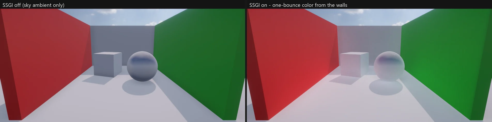

# Screen Space Global Illumination (동적 GI)

굽지 않는 **실시간 간접광**입니다. 해를 받은 바닥 · 벽의 빛이 둘레를 물들입니다 — 빨간 카펫 옆 흰 벽이 붉게, 해 든 골목 바닥이 그늘진 벽을 밝게. 미리 계산 (라이트맵 · 프로브 굽기) 이 없어 50 km 월드처럼 큰 곳, 낮 · 밤이 도는 장면, 움직이는 물체에도 바로 맞습니다. 이름과 값은 Unity **HDRP 의 Screen Space Global Illumination** (Volume 효과) 와 같습니다.

## 쓰는 법

Volume 프로필 > Add Override > Lighting > **Screen Space Global Illumination**.

| 값 | 뜻 |
|---|---|
| Enable | 켜기 |
| Quality | Low (광선 1 개 · 16 걸음) · Medium (2 · 24) · High (4 · 32) — 픽셀마다 |
| Full Resolution | 끄면 반 해상도 (기본 — 시간 누적 · 흐림으로 매끈) |
| Max Ray Length | 광선 최대 길이 (m) |
| Depth Tolerance | 깊이 버퍼 뒤로 이만큼 (m) 안이면 맞음 (두꺼운 물체 · 얇은 물체 사이) |
| Denoise · Denoiser Radius | 깊이 · 노멀을 지키는 흐림 |
| Multiplier | 세기 (NOVA — 1 = 물리적으로 맞는 값) |

- 화면에 보이는 것만 빛을 준다 (화면 밖 · 가려진 면은 못 준다 — HDRP 와 같다). 하늘빛 · 먼 빛은 원래 환경광 (하늘 · Adaptive Probe Volume) 이 준다
- Game · Scene 뷰 둘 다. Reflection Probe · Adaptive Probe Volume 찍기에는 들어가지 않는다
- 켜면 후처리 HDR 타깃을 쓴다 (지난 프레임 장면 색이 필요)

## 동작 (엔진 안)

1. **광선** (`69. Ssgi.fx` Trace): 깊이 프리패스 (SSAO 의 뷰 노멀 · 깊이) 위에서 픽셀마다 코사인 분포 방향으로 뷰 공간을 걷는다 (가까이 촘촘히). 깊이 버퍼 뒤로 Depth Tolerance 안이면 맞음, 그 면이 광선 쪽을 보면 그 자리를 **지난 프레임 장면 색** (Screen Space Reflection 과 같은 히스토리, 밉 체인) 에서 지난 ViewProj 로 되돌려 읽는다 — 카메라가 움직여도 맞다. 맞은 광선의 평균 = 확산 조도 / π
2. **시간 누적**: 지난 결과와 섞기 (90 %), 뷰 깊이가 다르면 버림. 광선 방향은 픽셀 · 프레임마다 돌아 몇 프레임이면 고르다
3. **흐림**: 가로 · 세로, 깊이 · 노멀이 다른 이웃은 빼고
4. **합치기**: 전체 해상도로 늘려 SSAO 결과 텍스처 (RGBA16F — r = AO, **gba = GI**) 에 — Lit 셰이더가 샘플러를 더 쓰지 않는다 (OpenGL 32 개 제한). `ShadeLit` 이 확산 환경광에 `diffuse × GI × Occlusion` 을 더한다 (`gSsaoParams.y` > 0 일 때만)

- 파일: `Source/Graphics/DX11/Ssgi.*` (패스 · 히스토리 · CLI), `Shaders/69. Ssgi.fx`, `Source/Graphics/DX11/Ssao.*` (결과 RGBA16F), `ScreenSpaceReflection` (`KeepHistory` · `GetHistory`), `Source/Graphics/Common/VolumeProfile.cpp` (Volume 값), `Source/Editor/EditorApp.cpp` (SSAO 다음 SSGI 패스)
- CLI: `nova ssgi info [--view scene]` — 켜짐 · 계산 크기 · 광선 · 걸음

## 검사

`Tools/tests/run_tests.ps1 -Only ssgi` — 해 받은 빨간 판 옆의 그늘진 흰 벽이 붉어진다 (하늘은 그대로), 정보 (반 해상도 · 광선 수), Multiplier 2 = 약 두 배, 판이 흰색이면 밝아지기만 하고 붉지 않다, High + Full Resolution, Scene 뷰, OpenGL.

## 아직

- 화면 밖 빛: 카메라 둘레 계단식 복셀 · SDF GI (Godot SDFGI · HDRP APV 실시간 갱신과 잇기) — 로드맵 1-1 다음 단계
- 두 번 이상 튕김 (지난 프레임 장면 색에 이미 지난 GI 가 들어 있어 몇 프레임에 걸쳐 조금씩 쌓인다), 스페큘러 GI (SSR 이 맡는다)
- 하늘빛 가림 (맞은 몫만큼 하늘 환경광을 줄이기 — 지금은 SSAO 가 가린다)
